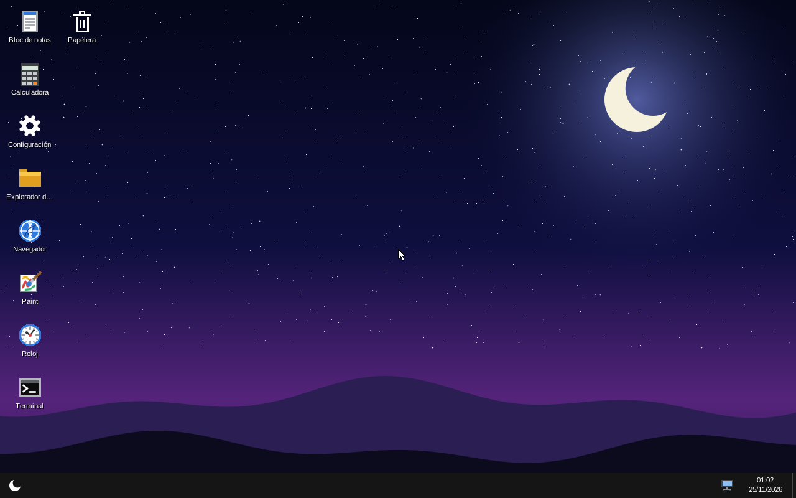
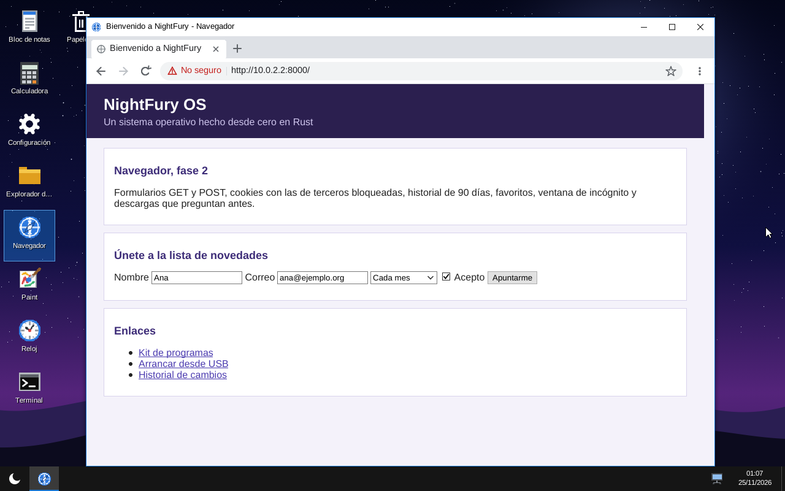
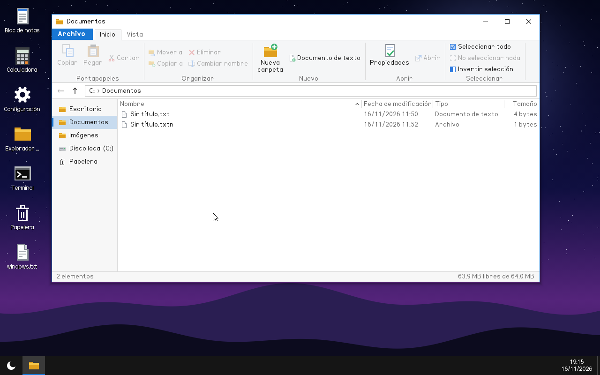
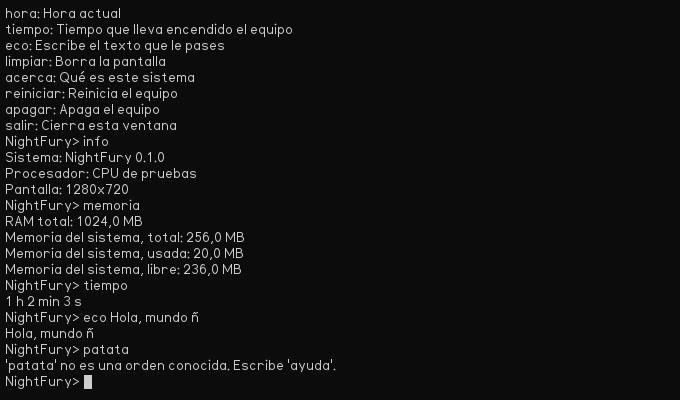
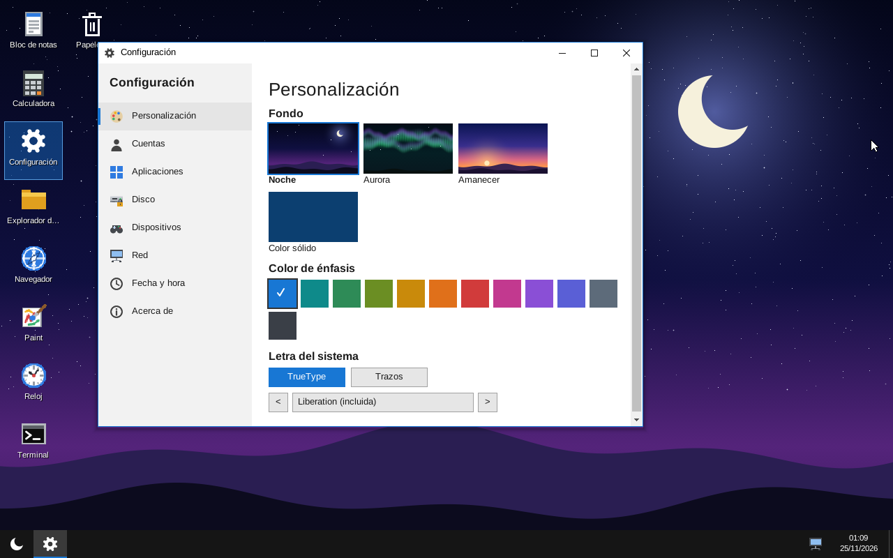

<div align="center">


# NightFury OS

**A desktop operating system written from scratch in Rust.**<br>
Its own kernel, windowing, file system, encryption, USB, networking and web browser. No third-party dependencies.

[](CHANGELOG.md)
[](LICENSE)
[](https://www.rust-lang.org)
[](#try-it)
[](Cargo.toml)

[Español](README.md) · **English**



</div>

## What it is

NightFury OS is an x86_64 operating system that boots through UEFI and is written entirely in Rust, with no
third-party crates. Everything is its own: kernel, window manager, font rendering, icons, file system, user
accounts, disk encryption, USB, networking, TLS and the web browser. It is built *clean room*: it starts from
public specifications and never copies anyone else's code ([rules and sources](docs/CLEANROOM.md)).

The user interface is in Spanish.

## What's new in 0.12.7

- **Alongside Windows or Linux**: installs into free space or a data partition, never shrinking anything.
- **Its own boot menu** at power-on to pick a system, with a countdown and the last choice as default.
- **Settings › Boot** (Configuración › Arranque): countdown, hide or rename entries.
- **Remove NightFury** from the USB stick, leaving Windows and Linux as they were.

Every version is in the [changelog](CHANGELOG.md) (in Spanish).

## Screenshots

| Web browser | File explorer |
|:---:|:---:|
|  |  |
| **Terminal** | **Settings** |
|  |  |

## Features

| Area | What it has |
|---|---|
| **Kernel** | UEFI boot, its own paging and GDT, user-mode processes (ring 3), multitasking and system calls |
| **Desktop** | Windows 10-style windows, Start menu, taskbar, context menus, drag and drop, wallpapers and accent colors |
| **Files and disks** | NFFS file system (copy-on-write), File Explorer with ribbon and Recycle Bin; SATA and NVMe; reads FAT, exFAT, ISO, UDF, NTFS and ext2/3/4 |
| **Accounts and security** | Password-protected accounts, full-disk or per-user folder encryption (AES-256-XTS), recovery code, per-program network permission |
| **USB** | Its own xHCI driver: keyboard, mouse, flash drives and gamepads |
| **Network** | Ethernet (Intel, Realtek, virtio), DHCP, DNS, TCP/UDP, HTTPS with TLS 1.3 and 1.2, Internet time, end-to-end encrypted **Mensajes** chat |
| **Web browser** | Tabs, HTML and basic CSS, PNG/JPEG/GIF images, forms, cookies, history, bookmarks, incognito and downloads |
| **Programs** | Notepad, Calculator, Settings, File Explorer, Browser, Paint, Clock and Terminal; a [KIT](docs/KIT-programas.md) to build and install your own programs |

## Try it

**Without building:** download the USB image (write it with Rufus or balenaEtcher) or the QEMU zip from the
[releases](https://github.com/FuryNocturn/NightFury-OS/releases). They are test builds: **Install erases the
disk you choose** and Secure Boot must be disabled ([guide](docs/USB.md), in Spanish).

**Building it:** you need Rust with the `x86_64-unknown-uefi` target and QEMU with the edk2 firmware.

```powershell
rustup target add x86_64-unknown-uefi
powershell -ExecutionPolicy Bypass -File run.ps1
```

- Tests: `cargo test -p nf-core -p nf-app -p nf-web -p navegador`
- USB stick, installer and the `nfdisk` tool: [docs/USB.md](docs/USB.md)

Tested in QEMU; not yet on real hardware.

> [!WARNING]
> The cryptography (SHA-2, PBKDF2, AES, AES-GCM, ChaCha20-Poly1305, X25519, RSA, ECDSA and the TLS used for
> HTTPS) is a custom, **unaudited** implementation, and HTTPS only checks certificate revocation when the
> server staples it. Do not rely on it for anything important.

## Roadmap

| Version | What it will bring |
|---|---|
| 0.12.8 | Encrypted password and personal data manager that fills forms in the browser |
| 0.13 | Image viewer, BMP, animated GIF, ZIP and faster redrawing |
| 0.14 | Multiple CPU cores, sound and a media player |
| 0.15 | Wi-Fi and IPv6 |
| 0.16 | Safe updates with A/B boot, and swap |
| 0.17 | Signed packages |
| 0.18 | JavaScript in the browser |

## Documentation

- [Program KIT](docs/KIT-programas.md): how to write programs for NightFury.
- [Booting from USB](docs/USB.md) and `nfdisk`.
- [Clean room](docs/CLEANROOM.md): rules and specifications used.
- [Changelog](CHANGELOG.md).

The documentation is in Spanish.

## License

Copyright (C) 2026 Tare Fernandez Salas (**FuryNocturn**).

**GPL-3.0** ([LICENSE](LICENSE)) with an additional term under section 7(b) ([NOTICE](NOTICE)): every copy or
derivative work must keep the NOTICE file and show this attribution in its "About" screen:

> **Basado en NightFury-OS de FuryNocturn** — https://github.com/FuryNocturn/NightFury-OS

Bundled fonts: Liberation 2.1.5, under the SIL Open Font License 1.1 ([license](nf-core/data/fuentes/LICENSE)).
