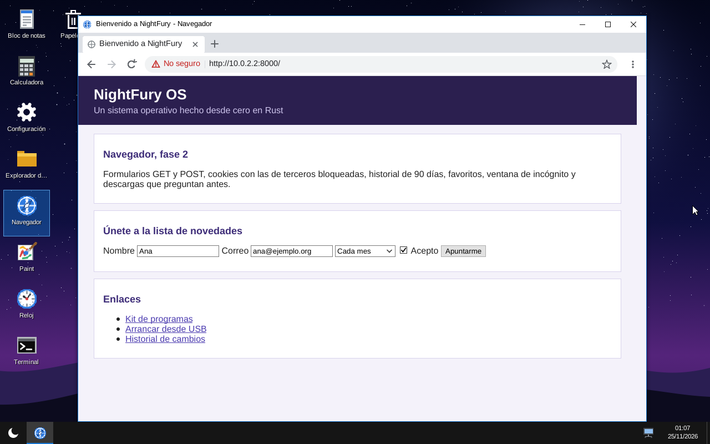
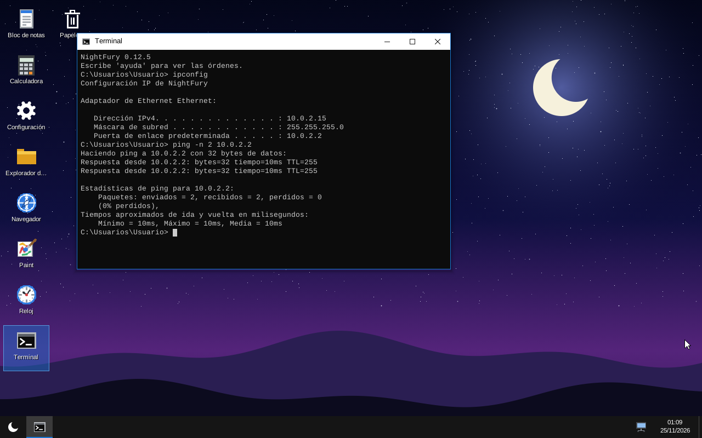
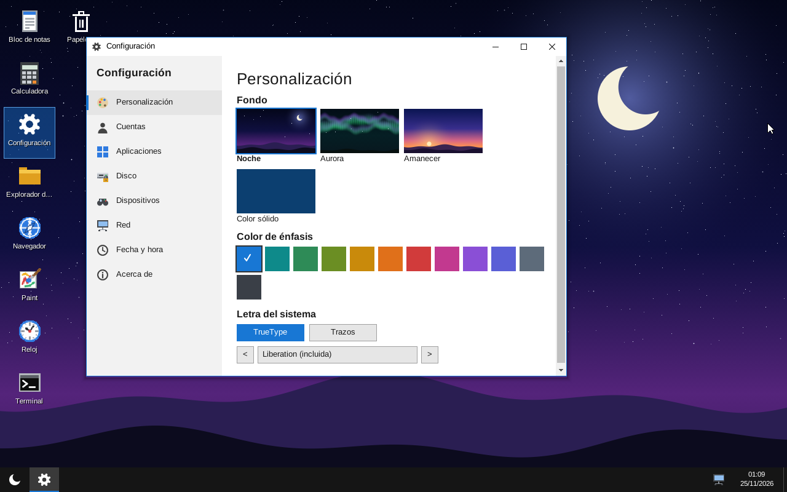

<div align="center">


# NightFury OS

**Un sistema operativo de escritorio hecho desde cero en Rust.**<br>
Núcleo, ventanas, archivos, cifrado, USB, red y navegador propios. Sin dependencias de terceros.

[](CHANGELOG.md)
[](LICENSE)
[](https://www.rust-lang.org)
[](#probarlo)
[](Cargo.toml)

**Español** · [English](README.en.md)


</div>

## Qué es

NightFury OS es un sistema operativo x86_64 que arranca por UEFI y está escrito por completo en Rust, sin
*crates* de terceros. Todo es propio: núcleo, gestor de ventanas, tipografía, iconos, sistema de archivos,
cuentas, cifrado de disco, USB, red, TLS y el Navegador. Se desarrolla en *sala limpia*: se parte de
especificaciones públicas y nunca se copia código ajeno ([reglas y fuentes](docs/CLEANROOM.md)).

## Novedades de la 0.12.5

- **Formularios** en el Navegador: GET y POST, con aviso si una contraseña va a viajar por http.
- **Cookies** en memoria, en disco solo para favoritos o sitios con «Recordar sesión»; las de terceros, bloqueadas.
- **Historial** de 90 días (Ctrl+H), **favoritos** con estrella, barra y carpetas (Ctrl+D, Ctrl+Mayús+O).
- **Incógnito** (Ctrl+Mayús+N) y **descargas** que preguntan antes y van a Descargas (Ctrl+J).
- **Letra TrueType suavizada** en todo el sistema; la de trazos sigue en Configuración → Personalización.

Todas las versiones en el [historial de cambios](CHANGELOG.md).

## Capturas

| Navegador | Explorador de archivos |
|:---:|:---:|
|  |  |
| **Terminal** | **Configuración** |
|  |  |

## Características

| Área | Qué tiene |
|---|---|
| **Núcleo** | Arranque UEFI, paginación y GDT propias, procesos en modo usuario (ring 3), multitarea y llamadas al sistema |
| **Escritorio** | Ventanas al estilo de Windows 10, menú Inicio, barra de tareas, menús contextuales, arrastrar y soltar, fondos y colores de énfasis |
| **Archivos y discos** | Sistema de archivos NFFS (copia al escribir), Explorador con cinta y Papelera; SATA y NVMe; lee FAT, exFAT, ISO, UDF, NTFS y ext2/3/4 |
| **Cuentas y seguridad** | Cuentas con contraseña, cifrado del disco entero o de la carpeta de cada usuario (AES-256-XTS), código de recuperación, permiso de red por programa |
| **USB** | Controlador xHCI propio: teclado, ratón, pendrives y mandos |
| **Red** | Ethernet (Intel, Realtek, virtio), DHCP, DNS, TCP/UDP, HTTPS con TLS 1.3 y 1.2, hora por Internet, chat **Mensajes** cifrado de extremo a extremo |
| **Navegador** | Pestañas, HTML y CSS básico, imágenes PNG/JPEG/GIF, formularios, cookies, historial, favoritos, incógnito y descargas |
| **Programas** | Bloc de notas, Calculadora, Configuración, Explorador, Navegador, Paint, Reloj y Terminal; [KIT](docs/KIT-programas.md) para crear e instalar programas propios |

## Probarlo

Necesitas Rust con el destino `x86_64-unknown-uefi` y QEMU con el firmware edk2.

```powershell
rustup target add x86_64-unknown-uefi
powershell -ExecutionPolicy Bypass -File run.ps1
```

- Pruebas: `cargo test -p nf-core -p nf-web -p navegador`
- Arrancar desde un pendrive y la herramienta `nfdisk`: [docs/USB.md](docs/USB.md)

Probado en QEMU; en hardware real todavía no.

> [!WARNING]
> La criptografía (SHA-2, PBKDF2, AES, AES-GCM, ChaCha20-Poly1305, X25519, RSA, ECDSA y el TLS de HTTPS) es
> una implementación propia **sin auditar**, y HTTPS solo comprueba si un certificado está revocado cuando el
> servidor lo adjunta. No protejas con ella nada importante.

## Hoja de ruta

| Versión | Qué traerá |
|---|---|
| 0.12.6 | Gestor de contraseñas y datos, cifrado, que rellena formularios en el Navegador |
| 0.13 | Visor de imágenes, BMP, GIF animado, ZIP y redibujo más rápido |
| 0.14 | Varios núcleos de CPU, sonido y reproductor multimedia |
| 0.15 | Wi-Fi e IPv6 |
| 0.16 | Actualizaciones seguras con arranque A/B y memoria de intercambio |
| 0.17 | Paquetes firmados |
| 0.18 | JavaScript en el Navegador |

## Documentación

- [Kit de programas](docs/KIT-programas.md): cómo hacer programas para NightFury.
- [Arranque desde USB](docs/USB.md) y `nfdisk`.
- [Sala limpia](docs/CLEANROOM.md): reglas y especificaciones consultadas.
- [Historial de cambios](CHANGELOG.md).

## Licencia

Copyright (C) 2026 Tare Fernandez Salas (**FuryNocturn**).

**GPL-3.0** ([LICENSE](LICENSE)) con un término adicional del §7(b) ([NOTICE](NOTICE)): toda copia u obra
derivada debe conservar el fichero NOTICE y mostrar en su pantalla «Acerca de» este crédito:

> **Basado en NightFury-OS de FuryNocturn** — https://github.com/FuryNocturn/NightFury-OS

Fuentes incluidas: Liberation 2.1.5, bajo la SIL Open Font License 1.1 ([licencia](nf-core/data/fuentes/LICENSE)).
