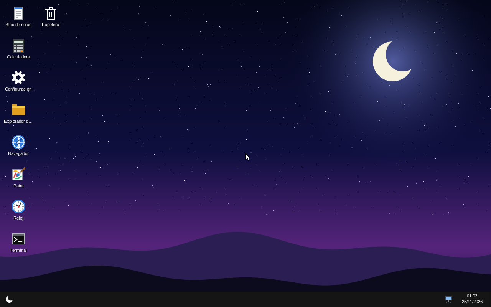

# NightFury-OS

**ES** · Sistema operativo x86_64 con arranque UEFI, escrito desde cero en Rust (*clean room*): núcleo, escritorio, ventanas, tipografía, iconos, sistema de archivos, cuentas, cifrado de disco, USB y red propios. Sin crates de terceros.

**EN** · An x86_64 UEFI operating system written from scratch in Rust (*clean room*): its own kernel, desktop, windowing, font, icons, file system, user accounts, disk encryption, USB and network stacks. No third-party crates.



| Explorador / File explorer | Terminal |
|---|---|
|  |  |

## Estado / Status
Versión 0.12.5, en desarrollo: **el Navegador, fase 2, y letra TrueType en todo el sistema**. El Navegador envía formularios (GET y POST, con aviso si una contraseña va por http), guarda cookies (en memoria; en disco solo de favoritos o sitios con «Recordar sesión»; las de terceros, bloqueadas), lleva historial de 90 días (Ctrl+H), favoritos con estrella, barra y carpetas (Ctrl+D, Ctrl+Mayús+O), ventana de incógnito (Ctrl+Mayús+N) y descargas que preguntan antes y van a Descargas (Ctrl+J). Todo el sistema se ve con letra TrueType suavizada; la de trazos queda en Configuración → Personalización. Aún sin JavaScript, así que muchas webs modernas se ven incompletas. La 0.12.4 trajo **el Navegador**: webs por HTTPS y HTTP (con la marca «No seguro») en una ventana con pestañas, letra TrueType, CSS básico, imágenes PNG, JPEG y GIF y búsqueda en DuckDuckGo desde la barra. La 0.12.3 trajo **la hora real**: Configuración → Fecha y hora elige la zona (horario de verano automático) y sincroniza la hora por Internet (desactivable); HTTPS usa la hora UTC real, comprueba la revocación cuando el servidor adjunta la respuesta OCSP y acepta P-384; el selector de archivos cambia de unidad, Ctrl+A selecciona en los campos de texto y desbloquear una unidad cifrada muestra «Desbloqueando…». La 0.12.2 trajo **HTTPS**: `curl https://…` en la Terminal comprueba el certificado del sitio con la lista de raíces de Mozilla (TLS 1.3 y 1.2); si no es válido se niega y explica por qué, `-k` conecta igual avisando, `-v` muestra la versión, el cifrado y el certificado, y `-L` sigue redirecciones. Un administrador puede añadir raíces propias en Configuración → Red → Certificados, y los programas tienen una «conexión segura» en el KIT que nunca se salta la comprobación. La 0.12.1 abrió la red a los programas de terceros con un aviso de permiso por programa, como un cortafuegos, y trajo **Mensajes**, un chat cifrado de extremo a extremo en la red local. La 0.12.0 trajo la red por cable (Intel 82540EM, 82574L, 82576, I210/I211, I217-I219 e I225/I226; Realtek RTL8111/8168; virtio-net), con DHCP, DNS, `ping`, `ipconfig`, `nslookup` y `curl`. Probado en QEMU; en hardware real todavía no.
Version 0.12.5, work in progress: **browser phase 2 and TrueType text across the whole system**. The browser submits forms (GET and POST, warning when a password would go over http), keeps cookies (in memory; on disk only for bookmarked sites or sites with "Remember session"; third-party cookies blocked), a 90-day history (Ctrl+H), bookmarks with a star, a bar and folders (Ctrl+D, Ctrl+Shift+O), an incognito window (Ctrl+Shift+N) and downloads that ask first and go to Downloads (Ctrl+J). The whole system now uses smooth TrueType text; the stroke font remains an option in Settings → Personalization. No JavaScript yet, so many modern sites look incomplete. 0.12.4 brought **the web browser** (Navegador): HTTPS and HTTP sites (marked "Not secure") in a tabbed window, TrueType text, basic CSS, PNG, JPEG and GIF images and DuckDuckGo search from the address bar. 0.12.3 brought **real time**: Settings → Date and time picks the time zone (automatic daylight saving) and syncs the clock over the Internet (can be turned off); HTTPS uses the real UTC time, checks revocation when the server staples an OCSP response, and accepts P-384; the file picker can switch drives, Ctrl+A selects text fields and unlocking an encrypted drive shows a progress indicator. 0.12.2 brought **HTTPS**: `curl https://…` in the Terminal checks the site's certificate against Mozilla's root list (TLS 1.3 and 1.2); if it is invalid it refuses and explains why, `-k` connects anyway with a warning, `-v` shows the version, cipher and certificate, and `-L` follows redirects. An administrator can add custom roots in Settings → Network → Certificates, and programs get a "secure connection" in the KIT that never skips the check. 0.12.1 opened the network to third-party programs behind a per-program permission prompt, like a firewall, and shipped **Mensajes**, an end-to-end encrypted chat on the local network. 0.12.0 brought wired networking (Intel 82540EM, 82574L, 82576, I210/I211, I217-I219 and I225/I226; Realtek RTL8111/8168; virtio-net) with DHCP, DNS, `ping`, `ipconfig`, `nslookup` and `curl`. Tested in QEMU; not yet on real hardware.

> **Aviso / Warning:** la criptografía (SHA-256/384/512, PBKDF2, AES-256-XTS, AES-GCM, X25519, HKDF, ChaCha20-Poly1305, RSA, ECDSA y el TLS de HTTPS) es una implementación propia **no auditada**, y HTTPS solo comprueba si un certificado está revocado cuando el servidor lo adjunta. No protejas con ella nada importante.
> The cryptography, including the TLS used for HTTPS, is a custom, **unaudited** implementation, and HTTPS only checks certificate revocation when the server staples it. Do not rely on it for anything important.

## Compilar y arrancar / Build and run
Requisitos / Requirements: Rust (con el target `x86_64-unknown-uefi`) y QEMU con firmware edk2.

```powershell
rustup target add x86_64-unknown-uefi
powershell -ExecutionPolicy Bypass -File run.ps1
```

Pruebas / Tests: `cargo test -p nf-core -p nf-web -p navegador`.
Fuentes incluidas / Bundled fonts: Liberation 2.1.5, SIL Open Font License 1.1 ([nf-core/data/fuentes/LICENSE](nf-core/data/fuentes/LICENSE)).
Arranque desde USB y herramienta `nfdisk` / USB boot and `nfdisk`: [docs/USB.md](docs/USB.md).
Hacer programas para el sistema / Writing programs: [docs/KIT-programas.md](docs/KIT-programas.md).
Reglas *clean room* y fuentes consultadas / Clean-room rules and sources: [docs/CLEANROOM.md](docs/CLEANROOM.md).

## Licencia / License
Copyright (C) 2026 Tare Fernandez Salas (**FuryNocturn**).

**GPL-3.0** ([LICENSE](LICENSE)) con un término adicional del §7(b) ([NOTICE](NOTICE)): toda copia u obra derivada debe conservar el fichero NOTICE y mostrar en su pantalla «Acerca de» el crédito:

GPL-3.0 with an additional term under section 7(b): every copy or derivative work must keep the NOTICE file and show this attribution in its "About" screen:

> **Basado en NightFury-OS de FuryNocturn** — https://github.com/FuryNocturn/NightFury-OS
